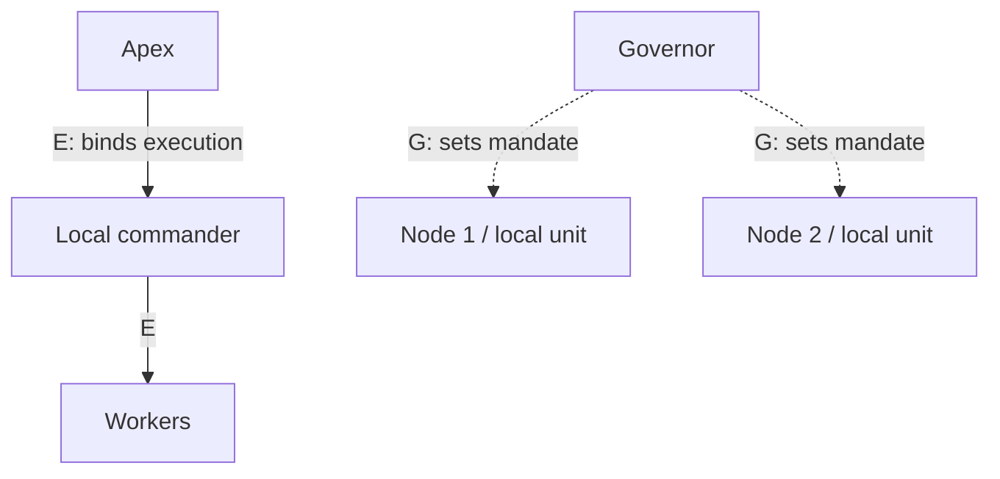

# Hive, Swarm, Fleet Reading Guide

**An unofficial reading companion to _Hive, Swarm, Fleet: Where execution command stops: repairing a taxonomy of multi-agent command structures_.**

For engineers, researchers, curious readers, and AI agents. This guide explains the proposed authority model, the author's classifications, and the reported simulation. **It does not reproduce the experiments or establish real-world LLM robustness.**

> Research credit: **Justin Bennington, Somewhere Systems**. Working paper **v1, 17 October 2026**, 11 PDF pages.
>
> [Author's paper page](https://somewhere.systems/research/hive-swarm-fleet) · [Official PDF](https://somewhere.systems/research/hive-swarm-fleet.pdf) · [Paper citation](references/paper.bib).
>
> Maintained by [0xHayd3n](https://github.com/0xHayd3n), with AI assistance. Independent and unaffiliated; no author endorsement is claimed. The exact supplied attachment and official public PDF were compared and have identical bytes.

## The idea in one minute

A team can have a shared message bus, a manager, and a process supervisor, yet these are three different kinds of structure. Bennington asks whose decisions can bind another agent's work, who sets a unit's mandate, and who can restart its processes. The proposed hive/fleet boundary follows **execution authority**, rather than a framework's name or its message-routing diagram. [§§3–4, PDF pp.2–4](https://somewhere.systems/research/hive-swarm-fleet.pdf#page=2)

| Relation | Operational question | What it does not establish by itself |
| --- | --- | --- |
| Execution E | Who can bind another agent's task, timing, or replanning? | That the same actor owns the mission or restarts processes. |
| Governance G | Who sets a unit's objective, budget, constraints, acceptance, and termination? | That this actor allocates individual members' work. |
| Lifecycle L | Who can start, stop, or restart a process? | That the supervisor dispatches its work. |
| Communication C | Who can send messages to whom? | Any command authority. |

Under the repair, a **hive** has one original command root reaching its other members. A **swarm** has no original internal command edges after qualifying conferred, member-revocable, term-bounded authority is filtered out; it can have an elected leader. A **fleet** connects at least two disjoint hive/swarm units, with execution authority stopping at each node's own unit. Separate names cover partitions and matrix arrangements. Read the full tests in [authority and taxonomy](docs/02-authority-and-taxonomy.md). [§4.2, p.3](https://somewhere.systems/research/hive-swarm-fleet.pdf#page=3)



Original orientation diagram: the left path illustrates continuing command; the right illustrates governance across unit boundaries. It is not a copied paper figure or an executable architecture. Lifecycle and communication are omitted for clarity.

## Start reading

| Your goal | Module |
| --- | --- |
| Understand what the initial taxonomy gets wrong | [1. Motivation and the eight-defect audit](docs/01-motivation-and-audit.md) |
| Follow the formal repair and difficult boundaries | [2. Authority, time, types, and four axes](docs/02-authority-and-taxonomy.md) |
| Interpret all 22 classifications | [3. Classification study](docs/03-classification-study.md) |
| Read the numerical results without overgeneralising | [4. Simulation, hypotheses, and limitations](docs/04-simulation-results-and-limits.md) |
| Place the work in context and inspect available code | [5. Context and source audit](docs/05-context-and-source-audit.md) |
| Locate every section, figure, table, formula span, and reference | [6. Complete paper map](docs/06-paper-map.md) |

**Short route:** this page → authority definitions → simulation limitations.

**Source-first route:** keep the exact v1 PDF open beside the paper map. All page citations use one-based PDF pages, which equal printed pages.

**Agent route:** [AGENTS.md](AGENTS.md) → [LLMS.txt](LLMS.txt) → [paper metadata](metadata/paper.json) → [typed claims](metadata/claims.json) and [reported results](metadata/results.json).

## What the paper reports

| Finding | Evidence type and practical limit | Location |
| --- | --- | --- |
| The original taxonomy has eight defects; E/G/L and a filtered authority digraph repair its intended distinctions | Proposed definitions plus counterexamples. Other repairs remain possible. | [§§3–4, pp.2–4](https://somewhere.systems/research/hive-swarm-fleet.pdf#page=2) |
| Command, communication, strategic ownership, and lifecycle are logically separable | Constructed contrasts, not a statistical independence analysis. | [§4.3, pp.3–4](https://somewhere.systems/research/hive-swarm-fleet.pdf#page=3) |
| Initial rules agree on 12 of 22 configurations, misclassify 3, and cannot resolve 7 | Author's documentation-based comparison against his repair; not an independent deployment census. | [§6, pp.5–6](https://somewhere.systems/research/hive-swarm-fleet.pdf#page=5) |
| Base throughput is 11.69 for each simulated structure | Below saturation, arrivals determine throughput. Equality does not mean equal maximum capacity. | [Table 2, p.6](https://somewhere.systems/research/hive-swarm-fleet.pdf#page=6) |
| Outage retention: hive 0.023 [0.022, 0.024], fleet 0.941 [0.933, 0.950], elected swarm 0.996 [0.988, 1.003] | Author-reported means and 95% bootstrap CIs, 200 seeds/condition. Fleet rerouting depends on spare capacity; these are simulated throughput ratios. | [§7.2 H3, p.7](https://somewhere.systems/research/hive-swarm-fleet.pdf#page=7) |
| Contract net uses 15.38 times the hive's messages/task; message slope is 1.946 per added agent | Counts messages, not their lengths, token bills, task quality, or real model deliberation. | [§7.2 H1–H2, pp.6–7](https://somewhere.systems/research/hive-swarm-fleet.pdf#page=6) |
| High-latency dispatch and simultaneous auctions expose additional bottlenecks | Unregistered, implementation-sensitive findings. Burst makespan 76.3 versus hive 28.7; the hive uses a two-task dispatch window. | [§7.2, pp.7–8](https://somewhere.systems/research/hive-swarm-fleet.pdf#page=7) |

H1 and H6 are reported as holding; H2–H5 are mixed. The [simulation module](docs/04-simulation-results-and-limits.md) preserves failed bounds, the tiny nonzero slope, ratios above 1, compatible abstract rounding, and three incorrect figure references. It does not turn partial outcomes into six successful predictions.

## Use it with an agent

```text
Using this guide and Bennington's 17 October 2026 v1 paper, classify this
specific configuration over a stated interval. List E, G, L and C separately.
Explain what authority evidence is missing. Separate the author's definitions,
his documentation-based examples, his simulation, and your own inference.
Cite source sections and PDF pages. Do not infer robustness from the label.
```

The metadata is a structured navigation aid, not raw experimental data. A leader can be present in a swarm, a shared board can fail centrally, and an elected dispatcher can retain central execution behaviour while its qualifying authority is removed from the classification digraph.

## What is available and what was checked

The actual attachment's complete text and all 11 rendered pages were read. The official PDF has the same **377,437 bytes** and SHA-256 as the attachment. Selected accessible Swarm/LangGraph source and provider documentation were statically inspected at recorded revisions. These checks support particular routing mechanisms, not every configuration's command semantics.

The author offers the **hsf package, 13,800 per-run results, preregistration, deviation log, and classification evidence “available from the author.”** No direct download was found on the paper page or in the scoped repository searches. We did not obtain or run those artifacts, verify the registration history, independently recode all 22 cases, or contact the author. [Source audit](docs/05-context-and-source-audit.md) · [Provenance](metadata/paper.json) · [Verification](VERIFICATION.md).

## Repository contents

```text
docs/                     Six human reading modules and complete source map
metadata/paper.json       Author, exact version, inventory, provenance, limits
metadata/claims.json      Typed claims with scope and source pages
metadata/results.json     Reported simulation numbers and caveats
metadata/classifications.json
metadata/sources.json     Source register and inspection boundaries
metadata/source-audit-notes.json
references/               Paper BibTeX and complete reference reading index
AGENTS.md, LLMS.txt        Agent navigation and evidence rules
CITATION.cff, ATTRIBUTION.md, LICENSE, CONTRIBUTING.md
VERIFICATION.md           Source and repository checks
scripts/validate_repository.py
.github/workflows/validate.yml
```

## Cite, reuse, and correct

Cite **Justin Bennington (2026)** for the paper and its research. The [preferred citation](CITATION.cff) points to the paper; the guide maintainer is credited separately. The [author page](https://somewhere.systems/research/hive-swarm-fleet) licenses the paper under **CC BY 4.0**. Original guide material is also CC BY 4.0. No paper PDF, complete extracted text, original figure, or author implementation is included. See [attribution](ATTRIBUTION.md).

Run:

```bash
python scripts/validate_repository.py
```

The check covers internal navigation, metadata, source locations, citation consistency, excluded assets, and numerical invariants. It does not evaluate the scientific validity of the taxonomy. Prepared **20 October 2026**; evidence-based corrections are welcome through [CONTRIBUTING.md](CONTRIBUTING.md).

