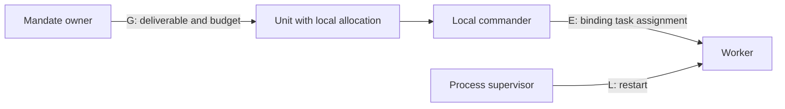

# 2. Reading the authority model

The repaired taxonomy classifies authority over a chosen unit and time interval. It starts with actual binding powers and then distinguishes their origin. A leader can have execution-command edges while its unit still counts as an elected swarm under the paper's filtered graph. Losing that distinction would undo the main repair. [§§4.1-4.2, PDF pp.2-3](https://somewhere.systems/research/hive-swarm-fleet.pdf#page=2)

This is an explanation of Justin Bennington's Working paper v1, 17 October 2026, not a replacement formal specification or a claim that the definitions have been validated on runtime traces.

## First choose the unit and interval

Let **A** be the universe of agents and **W** a unit drawn from A. The paper assumes W keeps its identity over the period being studied. Use a stable membership rule before asking who commands whom: a session's workers, a persistent team, and a federation of teams are different possible boundaries.

The subscript **t** matters. Authority can be granted, revoked, or changed. An outage alone does not rename a hive a swarm; a change in the source and revocability of authority can change the type. [§4.1, PDF p.2](https://somewhere.systems/research/hive-swarm-fleet.pdf#page=2); [§4.2, PDF p.3](https://somewhere.systems/research/hive-swarm-fleet.pdf#page=3)

## Four relations answer different questions

The source uses formal relations without numbered equations. The notation below is an explanatory restatement. [§4.1, PDF pp.2-3](https://somewhere.systems/research/hive-swarm-fleet.pdf#page=2)

| Symbol | Object related | Operational question | A useful distinction |
| --- | --- | --- | --- |
| **E_t** | An actor and an individual agent | Can this actor alone bind the recipient's work, timing, or replanning? | Advice, information, and offers the recipient may decline do not create E. |
| **G_t** | An actor and a set of agents | Can this actor set the unit's objective, constraints, budget, acceptance, or termination? | A deliverable can be mandated while allocation among members remains internal. |
| **L_t** | A supervisor and an agent | Can the supervisor start, stop, or restart the agent? | The supervisor can be an agent, a human, or an operating-system service. |
| **C_t** | Message participants | Who can communicate with whom? | A channel conveys no authority merely by existing. |

For example, suppose an owner asks a team to produce a tested library within a budget. The team selects contributors and schedules their work. That is G over the unit in this model. If the owner then directly allocates a named contributor's next task, that introduces E over an individual. A service that restarts the contributor's process supplies L. All three actions might travel over the same chat interface C.

Termination appears in G's mandate powers and stop appears in L's process powers. A practical audit should distinguish cancelling a unit's mission from stopping a process and record when one mechanism implements both. That is a guide-level clarification question; the paper does not provide an exhaustive operational instrumentation scheme.

## Execution edges versus the classification graph

The complete E relation records binding task-level decisions, including those made by an elected leader. The classification graph **D_t(W)** starts with the E edges whose endpoints lie in W, then removes edges that are all of the following:

1. **Conferred:** a protocol run by the members installed the authority.
2. **Member-revocable:** members other than the authority holder can remove it through protocol actions alone.
3. **Term-bounded:** the authority has the required temporal bound.

Do not read this as removing any edge that meets only one condition. The swarm definition requires the three conditions together. The source also calls an edge **derived from c** when c can create and remove it at will. Replacing a delegated sub-coordinator therefore does not automatically turn an apex-rooted command structure into a swarm. [§4.1, PDF p.3](https://somewhere.systems/research/hive-swarm-fleet.pdf#page=3)

The graph's roots are vertices with outgoing edges and no incoming edges. The notation **E_t+** means reachability along one or more execution-command edges, not just direct communication. In a hierarchy, an apex can reach a leaf through intermediate commanders even when they never exchange a message directly.

### Example: a replaceable dispatcher

In an original guide example, a team elects one dispatcher for a bounded term and the other members can revoke that role through their protocol. The dispatcher may issue binding assignments, so E is not empty. If all internal execution-command edges satisfy the three exceptions, D has no edges and the unit is an **elected swarm**. If an owner instead appoints the dispatcher and only the owner can remove it, that fact alone does not satisfy member revocability. One must inspect the retained graph before assigning a type.

## The repaired types

These conditions are the author's proposal, summarized from [§4.2, PDF p.3](https://somewhere.systems/research/hive-swarm-fleet.pdf#page=3). They are not product names or measured reliability grades.

| Type | Test in the proposed model | Consequence for reading |
| --- | --- | --- |
| **Hive** | D has one root and every other member is reachable from it. Depth is the longest command path. | Nested commanders can still form a single hive. Hierarchy depth is separate from the number of machines. |
| **Swarm** | D has no edges throughout the chosen interval. Any internal binding authority meets the conferred, member-revocable, term-bounded conditions. | It is **elected** if such a temporary role exists and **leaderless** otherwise. External governance and lifecycle control remain possible. |
| **Partition** | Several roots have disjoint reach. | Several separate command domains do not become a swarm merely because no single root commands everyone. |
| **Matrix** | A member is reached by two roots with original authority; the paper also places overlapping units in matrix organisations. | Shared command differs from several actors jointly governing a mandate. |
| **Fleet** | At least two coordinated nodes root or govern at least two disjoint hive/swarm units, with execution-command boundaries respected. | The unit boundary, coverage, connectivity, and authority conditions all matter. |

### The four fleet conditions

The paper requires more than several autonomous-looking nodes:

1. Every constituent unit is a hive or swarm, and the units are disjoint.
2. Every unit is rooted or governed by a node, and every node roots or governs a unit.
3. A node cannot hold execution command over a member of a unit it does not root.
4. Nodes form a connected coordination graph through lateral links and shared governors.

The third condition distinguishes the two superficially similar drawings in Figure 1a-b. If apex **s** commands sub-commanders and execution authority reaches their workers, the whole is a deep hive. If s governs the units' deliverables and each node decides its own internal allocation, the paper calls the whole a governed fleet. Several nodes governing one unit is **joint governance**, distinct from two original roots commanding the same individual. [§4.2, PDF p.3 and Figure 1, PDF p.4](https://somewhere.systems/research/hive-swarm-fleet.pdf#page=3)

This is an original explanatory diagram. The box-to-commander connector is a membership cue, not another authority edge; it is not a reproduction of Figure 1 or an executable classifier.

## Four axes and what independence means

The axes separate questions commonly collapsed into one architecture label. [§4.3, PDF pp.3-4](https://somewhere.systems/research/hive-swarm-fleet.pdf#page=3)

| Axis | Read from | Example values supplied by the paper |
| --- | --- | --- |
| Command locus | D(W) | One root, no retained command edges, several disjoint roots, dual command; also depth |
| Communication topology | C | Star, tree, mesh, ring, shared medium |
| Strategic ownership | G | Internal or external; single or joint |
| Lifecycle control | L | Self, coordinator, external supervisor, human |

The author argues logical separability through examples. A hive can communicate through a manager or through pairwise conversations. A star can carry dispatcher commands or merely transport blackboard updates. The same hive can serve an external user or its own backlog. A team can keep the same command and ownership while changing from session-bound workers to externally restarted processes.

These are counterexamples to necessary identity between the axes. They are not a statistical study showing that command and communication choices are uncorrelated in deployed systems. The paper explicitly acknowledges that common combinations exist.

## Time and failure do not automatically change the type

A failed coordinator restarted through L is described as a hive with a lifecycle gap. It has not acquired a member-run election protocol. Conversely, a swarm can change type if it grants a leader unrestricted, non-revocable authority. Classification concerns institutional authority over an interval, rather than a single frame in which a crashed process emits no messages. [§4.2, PDF p.3](https://somewhere.systems/research/hive-swarm-fleet.pdf#page=3)

This also explains why a leaderless communication pattern cannot prove fault tolerance. A shared board, routing service, storage system, or supervisor may remain a failure dependency even when D is empty. The simulation studies specified outages; it does not demonstrate survival of every possible component loss.

## Boundaries and questions the guide leaves open

The source's classifier uses hand-encoded authority graphs; extracting E, G, and L from live traces is future work. The following are reading questions, not additional paper results or silently repaired definitions. [§9, PDF p.9](https://somewhere.systems/research/hive-swarm-fleet.pdf#page=9)

- **Singletons and unit boundaries:** A one-member unit has no internal outgoing edge, so the literal root definition does not make it a hive; an edge-empty singleton instead meets the swarm's graph test. Table 1's phrase singleton nodes should not automatically be read as singleton subordinate units: §6 also says those nodes can command local hives. State whether a node, its governed unit, or its delegated workers are inside W before reasoning about this boundary case.
- **Cycles:** A graph with retained cyclic authority can have no root while still having edges. It is therefore not a swarm under the empty-D rule. The short list of named types is not presented with a proof that every possible digraph receives exactly one label; a finite longest path also needs care if cycles are admitted.
- **Terms and intervals:** A stated term or election timeout needs operational interpretation. Record who can revoke whom, under what protocol, and within which time window instead of inferring these properties from the word elected.
- **Binding governance:** Routing a deliverable to a unit counts as G in the simulation. Applying that distinction elsewhere requires evidence that the receiving node retains internal allocation decisions.
- **Implementation versus permissions:** A protocol might formally allow refusal while incentives or application code make refusal ineffective. The taxonomy needs an explicit authority interpretation; observed message traffic alone is insufficient.

For a practical reading exercise, draw E, G, L, and C separately, state W and the interval, justify every filtered edge, then apply the type conditions. Record unresolved authority facts instead of forcing a label. Continue to [the simulation results](04-simulation-results-and-limits.md) and the [source audit](05-context-and-source-audit.md).
